```{r setup}
#| include: false
library(ggplot2)
library(dplyr)

INK    <- "#1a1a2e"
PURPLE <- "#361a54"
BRIGHT <- "#993bff"
WARM   <- "#f56300"
CYAN   <- "#30d6ff"
PALE   <- "#eedeff"
GREY   <- "#666688"

theme_talk <- function(base = 15) {
  theme_minimal(base_size = base) +
    theme(
      plot.title      = element_text(face = "bold", colour = PURPLE, size = rel(1.05)),
      plot.subtitle   = element_text(colour = GREY, size = rel(0.85)),
      axis.text       = element_text(colour = INK),
      axis.title      = element_text(colour = GREY, size = rel(0.85)),
      panel.grid.minor = element_blank(),
      panel.grid.major.x = element_blank(),
      panel.grid.major.y = element_line(colour = "#e8e4f0", linewidth = 0.4),
      plot.background  = element_rect(fill = "#FAFAFA", colour = NA),
      panel.background = element_rect(fill = "#FAFAFA", colour = NA),
      legend.position = "top",
      legend.title    = element_blank()
    )
}
knitr::opts_chunk$set(dev.args = list(bg = "#FAFAFA"))

# ---------------------------------------------------------------------------
# The record. Counted from the Claude Code session transcripts held locally
# (~250 MB of JSONL across 10 sessions) and from git history across the
# project repositories. Snapshot taken 26 September 2026.
# ---------------------------------------------------------------------------

days <- as.Date(c(
  "2026-04-13","2026-04-14","2026-04-21","2026-04-26","2026-04-29","2026-04-30",
  "2026-05-01","2026-05-05","2026-05-06","2026-05-08","2026-05-11","2026-05-12",
  "2026-05-13","2026-05-14","2026-05-15","2026-05-16","2026-05-17","2026-05-19",
  "2026-05-20","2026-05-21","2026-05-22","2026-06-02","2026-06-09","2026-06-10",
  "2026-06-11","2026-06-30","2026-07-01","2026-07-02","2026-07-03","2026-07-04",
  "2026-07-08","2026-07-10","2026-07-15","2026-07-16","2026-07-21","2026-07-22",
  "2026-07-23","2026-07-24","2026-07-27","2026-07-29","2026-08-08","2026-08-09",
  "2026-08-14","2026-08-16","2026-08-17","2026-08-18","2026-08-19","2026-08-25",
  "2026-08-26","2026-08-27","2026-08-28","2026-09-01","2026-09-02","2026-09-03",
  "2026-09-04","2026-09-07","2026-09-08","2026-09-09","2026-09-10","2026-09-11",
  "2026-09-13","2026-09-15","2026-09-16","2026-09-17","2026-09-21","2026-09-22",
  "2026-09-24","2026-09-25","2026-09-26"))

tool_calls <- c(121,105,43,74,57,66,39,82,118,83,525,13,57,70,112,12,3,316,15,28,
                69,14,19,218,179,3,192,328,208,39,11,37,119,11,80,102,107,15,42,7,
                58,383,481,380,678,308,274,283,251,91,48,22,176,18,138,75,224,462,
                1140,558,624,597,686,96,408,321,441,170,321)

instructions <- c(13,30,4,30,14,14,5,22,16,17,45,1,4,11,21,1,1,26,1,8,11,4,2,16,15,
                  15,39,33,36,8,3,3,14,7,29,15,21,7,7,5,16,12,19,31,57,42,37,21,12,
                  5,6,11,17,8,9,12,12,31,44,26,41,52,73,5,68,35,16,11,17)

rec <- tibble(day = days, tool_calls = tool_calls, instructions = instructions)

N_INSTR   <- 1277L  # real instructions, after removing system-generated messages
N_TOOLS   <- sum(tool_calls)     # 13451
N_DAYS    <- length(days)        # 69
N_ELAPSED <- 166                 # days from first message to last
N_HOURS   <- 108                 # summing gaps under 10 minutes

# Scenario outputs from the model itself, for the worked examples.
BHS  <- file.path(Filter(dir.exists, file.path(dirname(here::here()), c("bh-school-system", "bh_school_system")))[1], "data")
hpc  <- readRDS(file.path(BHS, "hove_park_campus.rds"))
vac  <- readRDS(file.path(BHS, "value_added_choice.rds"))
short_sch <- function(x) {
  x <- sub(" (School|Catholic School|High School|Community Academy)$", "", x)
  sub("Portslade Aldridge", "Portslade", sub("Brighton Aldridge", "BACA", x))
}

fam <- tibble(
  what = factor(c("Running shell & R", "Writing code and prose", "Reading the codebase",
                  "Driving a browser", "Looking things up", "Other"),
                levels = rev(c("Running shell & R", "Writing code and prose",
                               "Reading the codebase", "Driving a browser",
                               "Looking things up", "Other"))),
  n = c(7953, 2919, 1088, 878, 196, 417))

library(tidyverse)
library(lme4)
library(lmerTest)
library(performance)
library(plotly)
library(leaflet)

library(sf)
library(knitr)
library(kableExtra)
library(scales)
library(htmlwidgets)
library(jsonlite)
library(here)
library(ggrepel)

source(here::here("R", "helpers.R"))

# ---- Load panel data ----
panel <- readRDS(here::here("data", "panel_data.rds"))

HIGHLIGHT_LA <- "Brighton and Hove"

# ---- Load pre-fitted models (Analysis E: imputed full panel) ----
# These are the same lmer models fitted in brighton_case_study.qmd / 05_fit_model.R
# Loading pre-fitted saves ~5 minutes of render time
models_imputed <- readRDS(here::here("data", "models_imputed.rds"))
mod_e_all      <- models_imputed$all
mod_e_disadv   <- models_imputed$disadvantaged
mod_e_nondisadv <- models_imputed$non_disadvantaged

# LA ranks for Brighton and Hove from the fitted models (1 = best), so the
# ranks quoted in the text cannot drift from the models they come from.
la_rank <- function(model) {
  re <- lme4::ranef(model)[["LANAME:gor_name"]]
  d  <- tibble(grp = rownames(re), eff = re[["(Intercept)"]]) %>%
    dplyr::mutate(la = sub(":.*$", "", grp)) %>%
    dplyr::arrange(dplyr::desc(eff)) %>%
    dplyr::mutate(rank = dplyr::row_number())
  bh <- d %>% dplyr::filter(grepl("Brighton", la))
  list(rank = bh$rank, n = nrow(d))
}
rk_all <- la_rank(mod_e_all)
rk_dis <- la_rank(mod_e_disadv)
rk_non <- la_rank(mod_e_nondisadv)

# Absence-control comparison: the LA effect with and without an absence term
r27 <- readRDS(here::here("data", "r27_la_absence.rds"))
r27_bh_dis <- r27$bh_dis

rank_with    <- r27_bh_dis$rank[r27_bh_dis$spec == "A-raw"]
rank_without <- r27_bh_dis$rank[r27_bh_dis$spec == "A-none"]

# ---- Prepare model dataset (for any analyses needing it) ----
imputed_full_data <- panel %>%
  filter(MINORGROUP %in% c("Academy", "Maintained school")) %>%
  filter(
    !is.na(ATT8SCR), ATT8SCR > 0,
    PTFSM6CLA1A > 0, PERCTOT > 0, PNUMEAL > 0,
    !is.na(OFSTEDRATING_1), !is.na(gor_name), !is.na(LANAME)
  ) %>%
  filter(
    !is.na(remained_in_the_same_school),
    !is.na(teachers_on_leadership_pay_range_percent),
    average_number_of_days_taken > 0,
    !is.na(gorard_segregation)
  ) %>%
  mutate(
    OFSTEDRATING_1 = factor(OFSTEDRATING_1,
                            levels = c("Outstanding", "Good",
                                       "Requires Improvement", "Inadequate"),
                            ordered = TRUE),
    gor_name   = factor(gor_name),
    LANAME     = factor(LANAME),
    year_label = factor(year_label)
  ) %>%
  droplevels()

contrasts(imputed_full_data$OFSTEDRATING_1) <-
  contr.treatment(levels(imputed_full_data$OFSTEDRATING_1))

# ---- Brighton & Hove data ----
bh_panel <- panel %>%
  filter(LANAME == HIGHLIGHT_LA,
         MINORGROUP %in% c("Academy", "Maintained school"))

# Add predictions from the imputed models
bh_panel <- bh_panel %>%
  mutate(
    predicted_all = predict(mod_e_all, newdata = bh_panel, allow.new.levels = TRUE),
    predicted_dis = predict(mod_e_disadv, newdata = bh_panel, allow.new.levels = TRUE),
    predicted_non = predict(mod_e_nondisadv, newdata = bh_panel, allow.new.levels = TRUE)
  )

# ---- Brighton & Hove: latest year per school (with model predictions) ----
bh_latest_model <- bh_panel %>%
  filter(!is.na(ATT8SCR)) %>%
  group_by(SCHNAME) %>%
  filter(year_label == max(year_label)) %>%
  ungroup()

# ---- Brighton & Hove: latest year per school (all columns) ----
bh_latest <- bh_panel %>%
  filter(!is.na(ATT8SCR)) %>%
  group_by(URN) %>%
  filter(year_label == max(year_label)) %>%
  ungroup()

# ---- National benchmarks (for FSM / absence plots) ----
national_benchmarks <- panel %>%
  filter(MINORGROUP %in% c("Academy", "Maintained school"),
         !is.na(ATT8SCR), ATT8SCR > 0,
         PTFSM6CLA1A > 0, PERCTOT > 0, PNUMEAL > 0,
         !is.na(OFSTEDRATING_1))

latest_year <- max(bh_latest_model$year_label, na.rm = TRUE)
national_latest <- national_benchmarks %>% filter(year_label == latest_year)

national_mean_abs <- mean(national_latest$PERCTOT, na.rm = TRUE)
bh_mean_abs <- mean(bh_latest_model$PERCTOT, na.rm = TRUE)
national_mean_fsm <- mean(national_latest$PTFSM6CLA1A, na.rm = TRUE)
bh_mean_fsm <- mean(bh_latest_model$PTFSM6CLA1A, na.rm = TRUE)

# ---- Reusable theme ----
theme_pub <- theme_minimal(base_size = 11) +
  theme(
    plot.title = element_text(face = "bold", size = 12),
    plot.subtitle = element_text(colour = "grey40", size = 10),
    strip.text = element_text(face = "bold"),
    legend.position = "bottom",
    panel.grid.minor = element_blank()
  )

# ---- Helper functions ----
relabel_terms <- function(term) {
  case_when(
    term == "(Intercept)" ~ "(Intercept)",
    term == "log(PTFSM6CLA1A)" ~ "log(% FSM)",
    term == "log(PERCTOT)" ~ "log(% Absence)",
    term == "log(PNUMEAL)" ~ "log(% EAL)",
    term == "ks2_c" ~ "Mean KS2 Prior Attainment",
    term == "gorard_segregation" ~ "Gorard Segregation",
    term == "ADMPOL_PTOTHER NON SEL" ~ "Admissions: Other non-selective (ref: non-sel. in highly sel. area)",
    term == "ADMPOL_PTSEL" ~ "Admissions: Selective (ref: non-sel. in highly sel. area)",
    term == "remained_in_the_same_school" ~ "Teacher Retention",
    term == "teachers_on_leadership_pay_range_percent" ~ "Leadership Pay %",
    term == "log(average_number_of_days_taken)" ~ "log(Teacher Sickness)",
    TRUE ~ term
  )
}

ordinal_suffix <- function(n) {
  suffix <- case_when(
    n %% 100 %in% c(11, 12, 13) ~ "th",
    n %% 10 == 1 ~ "st",
    n %% 10 == 2 ~ "nd",
    n %% 10 == 3 ~ "rd",
    TRUE ~ "th"
  )
  paste0(n, suffix)
}

# ---- Output format helper ----
tbl_fmt <- if (knitr::is_html_output()) "html" else "latex"

# ---- LA-level rankings (for accelerating returns section) ----
la_means_abs <- national_benchmarks %>%
  filter(year_label == latest_year) %>%
  group_by(LANAME) %>%
  summarise(la_mean_abs = mean(PERCTOT, na.rm = TRUE), .groups = "drop") %>%
  arrange(la_mean_abs) %>%
  mutate(rank = row_number(), pctile = rank / n() * 100)

la_means_fsm <- national_benchmarks %>%
  filter(year_label == latest_year) %>%
  group_by(LANAME) %>%
  summarise(la_mean_fsm = mean(PTFSM6CLA1A, na.rm = TRUE), .groups = "drop") %>%
  arrange(la_mean_fsm) %>%
  mutate(rank = row_number(), pctile = rank / n() * 100)

n_las_bench <- nrow(la_means_abs)
bh_abs_rank <- la_means_abs %>% filter(grepl("Brighton", LANAME))
bh_fsm_rank <- la_means_fsm %>% filter(grepl("Brighton", LANAME))
n_bh_schools <- nrow(bh_latest_model)
n_above_nat_abs <- sum(bh_latest_model$PERCTOT > national_mean_abs, na.rm = TRUE)


# Two sources, one deck.
#  - The attainment evidence: this repository (How to Pull the Right Lever),
#    read from its cached model fits.
#  - The city system: the bh-school-system repository (the strategic view,
#    the model guide and the simulator), read from its assembled data.

# ---- The city system -------------------------------------------------
BHS <- Filter(dir.exists, file.path(dirname(here::here()), c("bh-school-system", "bh_school_system")))[1]
# 00_core.R takes its root from here::here(), which is this repository
# when the deck renders, so it is evaluated with the root swapped in.
core <- readLines(file.path(BHS, "R", "00_core.R"), encoding = "UTF-8", warn = FALSE)
eval(parse(text = sub("here::here()", "BHS", core, fixed = TRUE), encoding = "UTF-8"))
source(file.path(BHS, "app", "R", "model.R"))
source(file.path(BHS, "app", "R", "outcomes.R"))

suppressPackageStartupMessages({
  library(lme4); library(knitr); library(kableExtra); library(scales)
  library(ggrepel); library(patchwork)
})
knitr::opts_chunk$set(dev = "ragg_png", dpi = 150, dev.args = list(bg = "#FAFAFA"))

inp   <- readRDS(file.path(BHS, "app", "data", "sim_inputs.rds"))
cop   <- bh_data("council_options.rds")
whx   <- bh_data("whitehawk_explained.rds")
acc   <- bh_data("accessibility.rds")
oi    <- bh_data("open_inputs.rds")
os    <- bh_data("open_scenarios.rds")
fpan  <- bh_data("factsheet_panel.rds")
rc    <- bh_data("reception_cohort.rds")
sfin  <- bh_data("school_finance.rds")
mt    <- bh_data("model_terms.rds")
lsoa  <- bh_data("lsoa.geojson") |> sf::st_transform(4326)
catch <- bh_data("catchments_current.geojson") |> sf::st_transform(4326)
sch   <- schools_sf(oi$schools) |> dplyr::filter(name != "Peacehaven Community School")
elm_pt <- sf::st_as_sf(data.frame(e = oi$elm_grove$easting, n = oi$elm_grove$northing),
                       coords = c("e", "n"), crs = 27700) |> sf::st_transform(4326)
CITY_X <- c(-0.25, -0.01); CITY_Y <- c(50.80, 50.885)

co  <- function(id, col, y = 2030) cop$runs[[col]][cop$runs$id == id & cop$runs$year == y]
whe <- function(id, col, y = 2026)
  cop$whitehawk_elm[[col]][cop$whitehawk_elm$id == id & cop$whitehawk_elm$year == y]
city   <- inp$schools[inp$schools$city & !(inp$schools$hypothetical %in% TRUE), ]
places <- sum(city$pan)
kids   <- function(y) inp$demand$cohort[inp$demand$year == y]
no30   <- acc$lsoa[acc$lsoa$places_30 < 1, ]
fmt_pct <- function(x, d = 0) paste0(formatC(x, format = "f", digits = d), "%")
gbp_m   <- function(x) sprintf("%s£%.1fm", ifelse(x < 0, "−", ""), abs(x) / 1e6)
ordinal <- function(n) paste0(n, ifelse(n %% 100 %in% 11:13, "th",
                                c("th", "st", "nd", "rd", rep("th", 6))[n %% 10 + 1]))

INK <- "#1f3b57"; MUTED <- "#6b7785"; ACCENT <- "#2a78d6"; WARM <- "#d95f02"; BAD <- "#b2182b"
PURPLE <- "#3A1857"; PINK <- "#ED357D"
theme_bhs <- function(base = 16)
  ggplot2::theme_minimal(base) +
  ggplot2::theme(panel.grid.major.y = ggplot2::element_blank(),
                 panel.grid.minor = ggplot2::element_blank(),
                 plot.title = ggplot2::element_text(face = "bold", colour = PURPLE),
                 plot.subtitle = ggplot2::element_text(colour = MUTED),
                 plot.title.position = "plot",
                 axis.text = ggplot2::element_text(colour = INK),
                 plot.background = ggplot2::element_rect(fill = "#FAFAFA", colour = NA))
theme_map <- function(base = 14)
  ggplot2::theme_void(base) +
  ggplot2::theme(plot.title = ggplot2::element_text(face = "bold", colour = PURPLE),
                 plot.subtitle = ggplot2::element_text(colour = MUTED),
                 plot.title.position = "plot",
                 legend.position = "right",
                 strip.text = ggplot2::element_text(face = "bold", size = base),
                 plot.background = ggplot2::element_rect(fill = "#FAFAFA", colour = NA))

# ---- The attainment evidence -----------------------------------------
panel <- readRDS(here::here("data", "panel_data.rds"))
HIGHLIGHT_LA <- "Brighton and Hove"
models_imputed <- readRDS(here::here("data", "models_imputed.rds"))
mod_e_all       <- models_imputed$all
mod_e_disadv    <- models_imputed$disadvantaged
mod_e_nondisadv <- models_imputed$non_disadvantaged

la_rank <- function(model) {
  re <- lme4::ranef(model)[["LANAME:gor_name"]]
  d  <- tibble(grp = rownames(re), eff = re[["(Intercept)"]]) %>%
    mutate(la = sub(":.*$", "", grp)) %>%
    arrange(desc(eff)) %>%
    mutate(rank = row_number())
  bh <- d %>% filter(grepl("Brighton", la))
  list(rank = bh$rank, n = nrow(d))
}
rk_all <- la_rank(mod_e_all)
rk_dis <- la_rank(mod_e_disadv)
rk_non <- la_rank(mod_e_nondisadv)
r27 <- readRDS(here::here("data", "r27_la_absence.rds"))
rank_without <- r27$bh_dis$rank[r27$bh_dis$spec == "A-none"]

# The national modelling dataset, as prepared in the Lever deck.
imputed_full_data <- panel %>%
  filter(MINORGROUP %in% c("Academy", "Maintained school")) %>%
  filter(!is.na(ATT8SCR), ATT8SCR > 0,
         PTFSM6CLA1A > 0, PERCTOT > 0, PNUMEAL > 0,
         !is.na(OFSTEDRATING_1), !is.na(gor_name), !is.na(LANAME)) %>%
  filter(!is.na(remained_in_the_same_school),
         !is.na(teachers_on_leadership_pay_range_percent),
         average_number_of_days_taken > 0,
         !is.na(gorard_segregation)) %>%
  droplevels()

# The Lever deck calls this bh_data; here that name is taken by the
# city system's loader, so the panel for the city's schools is bh_panel.
bh_panel <- panel %>%
  filter(LANAME == HIGHLIGHT_LA, MINORGROUP %in% c("Academy", "Maintained school"))
bh_latest_model <- bh_panel %>%
  filter(!is.na(ATT8SCR)) %>%
  group_by(SCHNAME) %>% filter(year_label == max(year_label)) %>% ungroup()

national_benchmarks <- panel %>%
  filter(MINORGROUP %in% c("Academy", "Maintained school"),
         !is.na(ATT8SCR), ATT8SCR > 0, PTFSM6CLA1A > 0, PERCTOT > 0, PNUMEAL > 0,
         !is.na(OFSTEDRATING_1))
latest_year <- max(bh_latest_model$year_label, na.rm = TRUE)
national_latest <- national_benchmarks %>% filter(year_label == latest_year)
national_mean_abs <- mean(national_latest$PERCTOT, na.rm = TRUE)
bh_mean_abs       <- mean(bh_latest_model$PERCTOT, na.rm = TRUE)
national_mean_fsm <- mean(national_latest$PTFSM6CLA1A, na.rm = TRUE)
bh_mean_fsm       <- mean(bh_latest_model$PTFSM6CLA1A, na.rm = TRUE)

la_means <- function(var) national_latest %>%
  group_by(LANAME) %>%
  summarise(m = mean(.data[[var]], na.rm = TRUE), .groups = "drop") %>%
  arrange(m) %>%
  mutate(rank = row_number(), pctile = rank / n() * 100)
la_abs <- la_means("PERCTOT"); la_fsm <- la_means("PTFSM6CLA1A")
bh_abs_rank <- la_abs %>% filter(grepl("Brighton", LANAME))
bh_fsm_rank <- la_fsm %>% filter(grepl("Brighton", LANAME))
abs_worst <- nrow(la_abs) - bh_abs_rank$rank + 1

theme_slide <- theme_minimal(base_size = 14) +
  theme(plot.title = element_text(face = "bold", size = 16, colour = PURPLE),
        plot.subtitle = element_text(colour = "grey40", size = 12),
        plot.title.position = "plot",
        strip.text = element_text(face = "bold"),
        legend.position = "bottom",
        panel.grid.minor = element_blank(),
        plot.background = element_rect(fill = "#FAFAFA", colour = NA))

# ---- Choice: what families respond to --------------------------------
DECAY_A <- acc$pref$decay
ch_prefs <- fpan$factsheets %>%
  filter(name != "Total", year >= max(year) - 4) %>%
  group_by(name) %>%
  summarise(p1 = mean(pref1), p2 = mean(pref2), p3 = mean(pref3), .groups = "drop") %>%
  inner_join(oi$attract %>% select(urn, name), by = "name")
cd <- os$choice %>%
  select(urn, school, pan, att8, va) %>%
  inner_join(ch_prefs %>% select(-name), by = "urn") %>%
  mutate(short = short_sch(school),
         wpp = (p1 + DECAY_A * p2 + DECAY_A^2 * p3) / pan)
fit_att8 <- lm(log(wpp) ~ att8, data = cd)
fit_va   <- lm(log(wpp) ~ va, data = cd)
r2_att8  <- summary(fit_att8)$r.squared
r2_va    <- summary(fit_va)$r.squared
att8_pct <- 100 * (exp(coef(fit_att8)[["att8"]]) - 1)
cd_of <- function(s, col) cd[[col]][cd$short == s]
GUIDE <- "https://www.brighton-hove.gov.uk/schools-and-learning/school-policies-reports-strategies-and-other-documents/secondary-school-admissions-guide-2027-2028"

```

# Background {background-color="#361a54"}

## Who I am, and why this talk {.smaller .intro}

:::::: columns
::: {.column width="56%"}
- **Professor of Urban Analytics** at UCL's Centre for Advanced Spatial
  Analysis. I build spatial models — of migration, of housing, of how
  people move around cities.
- Also **a parent in Brighton & Hove**, and one of hundreds of families
  drawn into a two-year public debate about secondary school admissions.
- I spent two years analysing the drivers of secondary attainment in
  England, published as *How to Pull the Right Lever*.

::: key-finding
What I found: the council's policies were unlikely to improve
attainment; the costs — longer journeys, community schooling breaking
up — were not weighed against them; and **absence, the single largest
factor, was not part of the decision at all**.
:::
:::

:::: {.column width="44%"}
[{width="94%"}](https://adamdennett.github.io/school_attainment_tool/)

::: {style="font-size:0.74em; color:#666688;"}
A misalignment runs through the whole episode, between the council's
**stated aims** (improving disadvantaged attainment), its **stated
problems** (falling rolls, school viability) and the **policies actually
chosen** (admission priorities, catchment boundaries, PAN cuts) — with
little attention paid to how those interact, or to what they cost
elsewhere in the system.
:::
::::
::::::
## Problems in the Brighton and Hove school system {.smaller}

- Some children have no secondary school near their home
- Declining pupil numbers with some schools affected more than others
- Policies promoting "choice" funnelling children away from peripheral
  schools already struggling for numbers
- Lots of engaged Parents, Schools, Councillors and Pressure Groups but
  a poor general understanding - *Collective Intelligence* - about how
  the whole system operates or how we might fix it to solve the
  interconnected challenges of attainment, absence, access and viability
- "Solutions" *without asking the right questions*

## The Brighton and Hove Secondary School System

```{r fig-catchments}
#| fig-cap: "Schools and Pupils in Brighton and Hove"

# ---- Load catchment boundaries ----
optionZ <- st_read(
  here::here("data", "optionZ_Mar25.geojson"),
  quiet = TRUE
) %>%
  st_transform(4326)

# ---- Catchment colour palette ----
catchment_colours <- c(
  "BACA"              = "#e41a1c",
  "HoveBlatchington"  = "#377eb8",
  "Longhill"          = "#4daf4a",
  "PACA"              = "#984ea3",
  "Patcham"           = "#ff7f00",
  "VarndeanStringer"  = "#a65628"
)
pal_catch <- colorFactor(
  palette = unname(catchment_colours),
  domain = names(catchment_colours)
)

# ---- Catchment labels ----
catchment_labels <- c(
  "BACA"              = "BACA (Brighton Aldridge)",
  "HoveBlatchington"  = "Hove Park / Blatchington Mill",
  "Longhill"          = "Longhill",
  "PACA"              = "PACA (Portslade Aldridge)",
  "Patcham"           = "Patcham",
  "VarndeanStringer"  = "Varndean / Dorothy Stringer"
)

# ---- School locations ----
bh_map_data <- bh_latest %>%
  filter(!is.na(easting), !is.na(northing)) %>%
  st_as_sf(coords = c("easting", "northing"), crs = 27700) %>%
  st_transform(4326)

map_coords <- st_coordinates(bh_map_data)
bh_map_data$lon <- map_coords[, 1]
bh_map_data$lat <- map_coords[, 2]

# ---- School logo paths (relative to project root) ----
logo_paths <- c(
  "Blatchington Mill School"                = "output/school_logos/blatchington_mill.png",
  "Brighton Aldridge Community Academy"      = "output/school_logos/brighton_aldridge.png",
  "Cardinal Newman Catholic School"          = "output/school_logos/cardinal_newman.png",
  "Dorothy Stringer School"                  = "output/school_logos/dorothy_stringer.png",
  "Hove Park School and Sixth Form Centre"   = "output/school_logos/hove_park.png",
  "King's School"                            = "output/school_logos/kings_school.png",
  "Longhill High School"                     = "output/school_logos/longhill_high.png",
  "Patcham High School"                      = "output/school_logos/patcham_high.png",
  "Portslade Aldridge Community Academy"     = "output/school_logos/portslade_aldridge.png",
  "Varndean School"                          = "output/school_logos/varndean.png"
)

# ---- Build the leaflet map ----
m_orient <- leaflet(width = "100%", height = 480) %>%
  add_basemap() %>%
  addPolygons(
    data = optionZ,
    group = "Catchment boundaries",
    fillColor = ~pal_catch(catchment),
    fillOpacity = 0.12,
    color = ~pal_catch(catchment),
    weight = 2.5,
    opacity = 0.8,
    label = ~catchment_labels[catchment],
    highlightOptions = highlightOptions(
      weight = 4, fillOpacity = 0.25, bringToFront = FALSE
    )
  )


# ---- Where the children actually live ----------------------------------
# One circle per postcode, sized by the number of households with
# dependent children and coloured by IDACI decile (1 = most deprived
# tenth of England). Rebuilt from the 2021 Census postcode tables and
# ONSPD centroids; the same layer as the Brighton consultation work.
# Drawn before the schools so the logos stay readable over it.
bh_pop <- readRDS(here::here("data", "bh_postcode_population.rds"))

pal_idaci <- colorFactor(
  palette = "RdYlBu",
  domain = sort(unique(bh_pop$idaci_decile))
)

m_orient <- m_orient %>%
  addCircleMarkers(
    data = bh_pop,
    group = "Where the children live",
    radius = ~sqrt(hh_dep_ch) * 1.5,
    fillColor = ~pal_idaci(idaci_decile),
    fillOpacity = 0.55,
    stroke = FALSE,
    label = ~sprintf(
      "%s - %.0f households with children, %.0f households in all, IDACI decile %.0f",
      postcode, hh_dep_ch, total_hh, idaci_decile
    )
  ) %>%
  addLegend(
    pal = pal_idaci,
    values = sort(unique(bh_pop$idaci_decile)),
    title = "IDACI decile<br><span style='font-weight:normal'>1 = most deprived</span>",
    opacity = 1,
    position = "bottomright"
  )
# Add each school as a dot + logo marker
for (i in seq_len(nrow(bh_map_data))) {
  sch_name <- bh_map_data$SCHNAME[i]
  sch_lon  <- bh_map_data$lon[i]
  sch_lat  <- bh_map_data$lat[i]

  popup_html <- sprintf(
    "<b>%s</b><br>ATT8: %.1f | FSM: %.1f%% | Absence: %.1f%%",
    sch_name,
    bh_map_data$ATT8SCR[i],
    bh_map_data$PTFSM6CLA1A[i],
    bh_map_data$PERCTOT[i]
  )

  m_orient <- m_orient %>%
    addCircleMarkers(
      lng = sch_lon, lat = sch_lat,
      radius = 5, fillColor = "#333333", fillOpacity = 0.9,
      group = "Schools",
      color = "white", weight = 1.5,
      popup = popup_html
    )

  logo_file <- logo_paths[sch_name]
  if (!is.na(logo_file) && file.exists(logo_file)) {
    logo_b64 <- knitr::image_uri(logo_file)
    logo_icon <- makeIcon(
      iconUrl = logo_b64,
      iconWidth = 36, iconHeight = 36,
      iconAnchorX = -4, iconAnchorY = 40
    )
    m_orient <- m_orient %>%
      addMarkers(
        lng = sch_lon, lat = sch_lat,
        icon = logo_icon,
        group = "Schools",
        popup = popup_html
      )
  }
}

# ---- CoMArt (Closed 2005) ----
comart_lon <- -0.099449
comart_lat <- 50.823301
comart_popup <- "<b>CoMArt (Closed 2005)</b>"

m_orient <- m_orient %>%
  addCircleMarkers(
    lng = comart_lon, lat = comart_lat,
    radius = 5, fillColor = "#e41a1c", fillOpacity = 0.9,
    group = "CoMArt (closed 2005)",
    color = "white", weight = 1.5,
    popup = comart_popup
  )

comart_logo <- "output/school_logos/comart.png"
if (file.exists(comart_logo)) {
  comart_b64 <- knitr::image_uri(comart_logo)
  comart_icon <- makeIcon(
    iconUrl = comart_b64,
    iconWidth = 36, iconHeight = 36,
    iconAnchorX = -4, iconAnchorY = 40
  )
  m_orient <- m_orient %>%
    addMarkers(
      lng = comart_lon, lat = comart_lat,
      icon = comart_icon,
      group = "CoMArt (closed 2005)",
      popup = comart_popup
    )
}

# Legend — use HTML labels with inline coloured squares for clean alignment
legend_html <- paste0(
  '<div style="font-size: 12px; line-height: 1.6;">',
  paste0(
    '<div style="display: flex; align-items: center; gap: 6px;">',
    '<span style="display: inline-block; width: 14px; height: 14px; ',
    'background:', unname(catchment_colours), '; ',
    'border-radius: 2px; flex-shrink: 0;"></span>',
    '<span>', unname(catchment_labels), '</span></div>',
    collapse = ''
  ),
  '</div>'
)

m_orient <- m_orient %>%
  addControl(
    html = paste0(
      '<div style="background: white; padding: 8px 12px; ',
      'border-radius: 4px; box-shadow: 0 1px 5px rgba(0,0,0,0.3); ',
      'font-family: sans-serif;">',
      '<div style="font-weight: bold; margin-bottom: 4px; font-size: 12px;">',
      '2025/26 Catchment Boundaries</div>',
      legend_html,
      '</div>'
    ),
    position = "topright"
  )

# Frame on where the children are, not on the full reach of the catchments:
# PACA's boundary runs west past Shoreham and would otherwise set the view.
bb <- as.numeric(sf::st_bbox(bh_pop))
m_orient <- m_orient %>%
  fitBounds(bb[1], bb[2], bb[3], bb[4])

# Let the room turn each layer off. Collapsed = FALSE so the options are
# visible on the slide rather than hidden behind a hover target.
m_orient <- m_orient %>%
  addLayersControl(
    overlayGroups = c("Where the children live", "Catchment boundaries",
                      "Schools", "CoMArt (closed 2005)"),
    options = layersControlOptions(collapsed = FALSE),
    position = "topleft"
  )

if (knitr::is_html_output()) {
  m_orient
} else {
  # Static map for PDF output
  ggplot() +
    geom_sf(data = optionZ, aes(fill = catchment), alpha = 0.15,
            colour = NA, show.legend = FALSE) +
    geom_sf(data = optionZ, aes(colour = catchment), fill = NA,
            linewidth = 0.6, show.legend = TRUE) +
    scale_fill_manual(values = catchment_colours, labels = catchment_labels,
                      aesthetics = c("fill", "colour"), name = "Catchment") +
    geom_point(data = as.data.frame(bh_map_data),
               aes(x = lon, y = lat), size = 2, colour = "#333333") +
    geom_text_repel(data = as.data.frame(bh_map_data),
                    aes(x = lon, y = lat, label = SCHNAME),
                    size = 2, max.overlaps = 15, force = 3,
                    segment.colour = "grey50", segment.size = 0.3) +
    # CoMArt
    geom_point(aes(x = comart_lon, y = comart_lat),
               size = 2, colour = "#e41a1c") +
    annotate("text", x = comart_lon + 0.005, y = comart_lat,
             label = "CoMArt (Closed 2005)", size = 2, colour = "#e41a1c", hjust = 0) +
    theme_void(base_size = 10) +
    theme(legend.position = "bottom",
          legend.text = element_text(size = 7))
}
```

## The cohort is already falling

```{r cohort}
#| fig-width: 11
#| fig-height: 5.2
y7 <- rc$secondary_city; recp <- rc$reception_city; proj <- rc$projection
ggplot() +
  geom_ribbon(data = proj, aes(entry_year, ymin = lo, ymax = hi), fill = BAD, alpha = 0.18) +
  geom_line(data = recp, aes(year, rec_offers), colour = "#2c7fb8", linewidth = 1.1) +
  geom_line(data = y7, aes(year, y7_offers), colour = INK, linewidth = 1.3) +
  geom_line(data = proj, aes(entry_year, central), colour = BAD, linewidth = 1.2, linetype = "22") +
  annotate("text", x = min(recp$year) + 0.3, y = max(recp$rec_offers) * 1.03,
           label = "Reception offers", colour = "#2c7fb8", hjust = 0, size = 4.4) +
  annotate("text", x = min(y7$year) + 0.3, y = min(y7$y7_offers) * 0.93,
           label = "Year 7 offers", colour = INK, hjust = 0, size = 4.4, fontface = "bold") +
  annotate("text", x = max(proj$entry_year) - 0.2, y = max(proj$hi) * 1.06,
           label = "Projected from children\nalready in primary school", colour = BAD, hjust = 1, size = 4) +
  scale_y_continuous(labels = scales::label_comma(), limits = c(0, NA)) +
  labs(x = NULL, y = "Offers",
       title = "Reception offers turned down first; Year 7 follows seven years later",
       subtitle = sprintf("Year 7 demand projected to fall to about %s by %s (from 2509 peak in 2019 - more than the entire current intake\n of two of the large schools in the city)",
                          fmt_n(proj$central[which.max(proj$entry_year)]), max(proj$entry_year))) +
  theme_bhs(15)
```

## Income is tied to numbers - and financial reserves are running out

```{r reserves}
#| fig-width: 12
#| fig-height: 5.6
fex <- sfin$exposure |> dplyr::mutate(short = short_sch(name))
ord <- fex |> dplyr::arrange(reserve_pct) |> dplyr::pull(name)
rp <- sfin$panel |> dplyr::mutate(school = factor(short_sch(name), short_sch(ord)), neg = pmin(reserve_pct, 0))
ggplot(rp, aes(year, reserve_pct)) +
  geom_hline(yintercept = 0, colour = "grey40", linewidth = 0.4) +
  geom_ribbon(aes(ymin = neg, ymax = 0), fill = "#d03b3b", alpha = 0.3) +
  geom_line(linewidth = 0.9, colour = INK) + geom_point(size = 1.2, colour = INK) +
  facet_wrap(~ school, ncol = 5) +
  scale_x_continuous(breaks = sort(unique(rp$year)),
                     labels = function(x) paste0(substr(x, 3, 4), "/", substr(x + 1, 3, 4))) +
  scale_y_continuous(labels = scales::label_percent()) +
  labs(x = NULL, y = "Reserve as a share of income",
       title = "Revenue reserves, worst first; red shading is a school in deficit",
       subtitle = "DfE school income and expenditure returns") +
  theme_bhs(12) + theme(axis.text.x = element_text(size = 7))
```

## School Allocations and Viability {.smaller}

```{r demand-drift}
#| fig-width: 12
#| fig-height: 5.4
fs <- bh_data("factsheet_panel.rds")$factsheets |>
  dplyr::filter(!is.na(off_total), name != "Total") |>
  dplyr::mutate(school = short_sch(name),
                lh = name == "Longhill High School")

ends <- fs |>
  dplyr::group_by(school, lh) |>
  dplyr::filter(year == max(year)) |>
  dplyr::ungroup()

city <- fs |>
  dplyr::group_by(year) |>
  dplyr::summarise(total = sum(off_total), .groups = "drop")
tot0 <- city$total[which.min(city$year)]
tot1 <- city$total[which.max(city$year)]

ggplot(fs, aes(year, off_total, group = school)) +
  # Longhill's admission number, for scale: it is now funded for 210 places
  # and filling well under half of them.
  geom_hline(yintercept = 210, linetype = "31", colour = "grey60", linewidth = 0.4) +
  annotate("text", x = max(fs$year) + 0.4, y = 210, hjust = 0, size = 3.4,
           colour = "grey45", label = "210 places") +
  geom_line(data = dplyr::filter(fs, !lh), colour = "grey78", linewidth = 0.8) +
  geom_line(data = dplyr::filter(fs, lh), colour = BAD, linewidth = 1.5) +
  geom_point(data = dplyr::filter(fs, lh), colour = BAD, size = 2) +
  ggrepel::geom_text_repel(
    data = dplyr::filter(ends, !lh), aes(label = school),
    size = 3.2, colour = "grey45", direction = "y", hjust = 0,
    nudge_x = 0.4, segment.colour = "grey80", segment.size = 0.3,
    max.overlaps = 20, xlim = c(max(fs$year) + 0.3, NA)) +
  ggrepel::geom_text_repel(
    data = dplyr::filter(ends, lh), aes(label = school),
    size = 4.2, fontface = "bold", colour = BAD, direction = "y", hjust = 0,
    nudge_x = 0.4, segment.colour = BAD, segment.size = 0.3,
    xlim = c(max(fs$year) + 0.3, NA)) +
  scale_x_continuous(breaks = seq(2010, 2026, 4),
                     limits = c(min(fs$year), max(fs$year) + 4.2)) +
  labs(x = NULL, y = "Children allocated a place",
       title = sprintf(
         "Despite %s more children in %d than in %d, some schools have been in decline",
         format(tot1 - tot0, big.mark = ","), max(city$year), min(city$year)),
       subtitle = "Places allocated at national offer day, by school. Source: BHCC allocation factsheets.") +
  theme_bhs(13) +
  theme(panel.grid.major.x = element_blank())
```

::: {style="font-size:0.78em"}
The city placed **1,900 children in 2010 and 2,250 in 2026**. Over the
same years **Longhill fell from 239 to 81**, and **Hove Park from 308 to
136**. Now the pupil roll is declining, serious problems ahead
:::

## An AI4CI problem, if ever there was one

::::::: columns
::: {.column width="70%"}
- The **UKRI National AI Research Hub for Collective Intelligence** -
  5-year, £12m EPSRC Project - asks what AI can do to enhance the
  thinking groups of people do together and the solutions they can
  arrive at.

- Can AI help us develop a **shared, inspectable account of how the
  school system in Brighton and Hove actually behaves**?

- The challenge: *If AI can help us get to an answer quicker - can I ask
  the right questions? Can this collaborative effort enhance our
  Collective Intelligence?*
:::

::::: {.column width="30%"}
::: {style="text-align:center; margin-bottom:0.2rem;"}
{width="46%"
style="vertical-align:middle; margin-right:12px;"}
:::

::: key-finding
A system where everyone is well informed about a *part* and nobody can
see the *whole* is not an information problem. It is a collective
intelligence problem.
:::
:::::
:::::::

## Why AI made this tractable {.smaller}

::::: columns
::: {.column width="50%"}
**What was expensive before**

- Harmonising a dozen published sources that do not share a key
- Building, calibrating and auditing a city-scale model
- Re-running everything when one assumption changes
- Writing it all down clearly enough for a non-specialist to check
- Turning it into something a parent/school leader/councillor/council
  officer can actually use
:::

::: {.column width="50%"}
**What that cost collapsing buys**

- Scenarios can be *tested* rather than asserted
- The work is **auditable**: every figure traces to code and a source
- A stakeholder can move a slider, change a number, see a knock-on
  impact themselves instead of taking my word for it
- Being wrong becomes cheap, so questions get asked that were not worth
  a week of someone's time (*"if we move/shrink school A, what happens
  to demand at school B?"*)
:::
:::::

::: key-finding
The point is not that AI did the analysis. It is that AI made *ideas
scalable and testable*, with a short timeline, *big urban models
achievable* the analysis **sharable and replicable** — one person could
build something the whole city can interrogate, argue with, and use.
That is the collective intelligence bit.
:::

# The Model {background-color="#361a54"}

## What exists now {.smaller}

| The thing                                        | Scale                 |
|:-------------------------------------------------|:----------------------|
| A strategic analysis of the city's school system | 9,712 lines of Quarto |
| The model itself, plus data assembly             | \~7,400 lines of R    |
| An interactive policy simulator (Shiny)          | \~3,000 lines         |
| Commits across six repositories                  | 805                   |

::: {style="font-size:0.8em"}
- A production-constrained spatial interaction model with a
  competing-destinations term, calibrated per catchment, fitted against
  the council's published offer data.
- It reproduces the September 2026 allocations with an ***R² of 0.95***.
- Alongside it: a technical guide auditing every model term, a private
  analysis repository, and three slide decks.
:::
## Questions I wanted to answer {.smaller}

>I won't answer these all today - but will show how they can now all be answered

- What is causing Longhill School's acute numbers problem - is it
  geography, demography, attractiveness, some combination or something
  else?
  - How do parents in the city choose which schools to send their
    children to - what makes a school attractive? What if parents chose
    differently?
- Would moving Longhill and/or shrinking it:
  - Help it survive in the medium term - 2035?
  - Improve accessibility or segregation in the city?
- How do current and previously proposed policies impact pupil
  displacement (students unable to attend their local school)?
- Given how the system operates, what policy levers can be pulled to
  maintain a viable school system in the city, 10 years from now?

## How I answered them - the model {.smaller}

A **spatial interaction model**: the same family of model used for
commuting, migration and retail catchments. It predicts how many
children flow from each neighbourhood to each school, given where they
live, how far each school is, and how much they want to go there.

$$T_{ij} \;=\; A_i\,O_i\;\;W_j\;\;c_{ij}^{-\beta}\;\;e^{\gamma_h}\;\;C_j^{\delta}$$

::::: columns
::: {.column width="52%"}
| Term           | What it is                                        |
|:---------------|:--------------------------------------------------|
| $T_{ij}$       | children from neighbourhood $i$ to school $j$     |
| $O_i$          | children living in $i$ — 195 neighbourhoods       |
| $W_j$          | how attractive school $j$ is                      |
| $c_{ij}$       | bus-and-walk journey time, $i$ to $j$             |
| $e^{\gamma_h}$ | the catchment bonus, if $j$ is in $i$'s catchment |
| $C_j$          | how much competition $j$ has nearby               |
| $A_i$          | the balancing term                                |
:::

::: {.column width="48%"}
It is **production-constrained**: $A_i$ forces every child living
somewhere to end up somewhere. The model never invents or loses children
— it only decides where they go.

That is what makes it useful for policy. Close a school, move one, cut
its admission number, and the children do not vanish. They reappear
somewhere else, and the model says where.
:::
:::::

## What the model had to learn {.smaller}

::::::: columns
:::: {.column width="52%"}
Three things are fitted to the council's own published allocations,
rather than assumed:

**Distance decay,** $\beta = 1.7$. How steeply demand falls as a school
gets further away.

**The catchment pull,** $\gamma_h$. How much living inside a catchment
raises the odds of choosing a school there — fitted **separately for
each catchment**, because they do not behave alike.

**Competition,** $\delta = 0.3$. Whether being surrounded by rivals
helps a school or hurts it.

::: key-finding
Living in the catchment multiplies the odds by **2.7× in Brighton
Aldridge's** and **13.5× in Stringer and Varndean's** — one policy doing
five times as much work in one place as another.
:::

Fitted this way, the model reproduces the 2026 offers with an **R² of
0.95**.
::::

:::: {.column width="48%"}
::: {style="text-align:center; line-height:0.8; margin-top:-0.4rem;"}
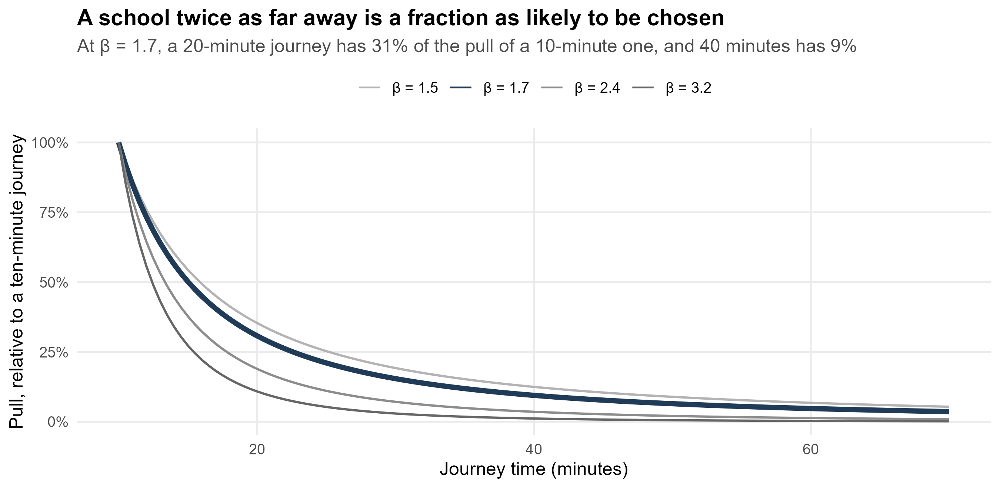{width="58%"
style="display:block; margin:0 auto;"}
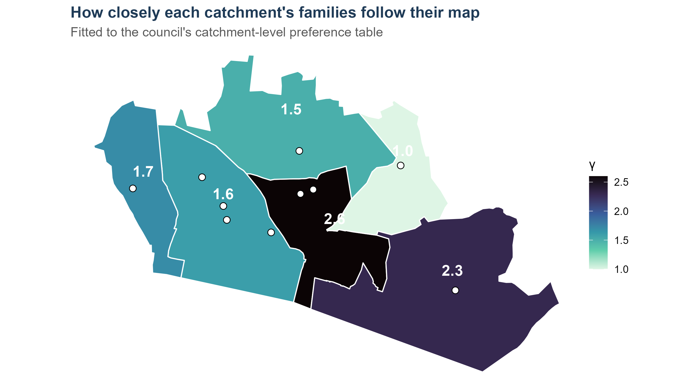{width="58%"
style="display:block; margin:0 auto;"}
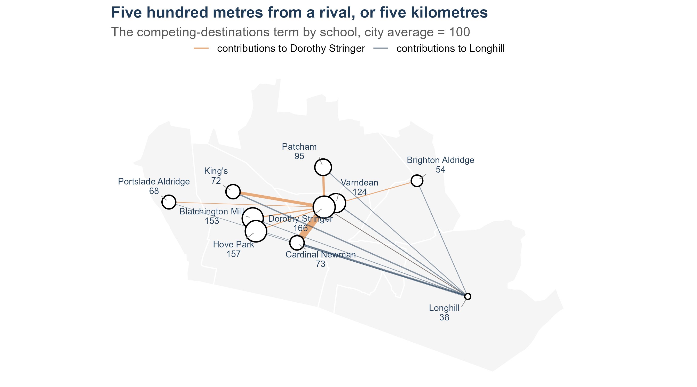{width="58%"
style="display:block; margin:0 auto;"}
:::
::::
:::::::

## What $c_{ij}$ actually means {.smaller}

```{r fig-route-baca}
#| fig-cap: "One neighbourhood in the Stringer/Varndean catchment to Brighton Aldridge. Walking legs orange and dashed, bus legs blue. Routed on the real timetable at 08:00."
gr <- bh_data("guide_routes.rds")
BACA <- "Brighton Aldridge Community Academy"

rt   <- gr$summary |> dplyr::filter(school == BACA)
legs <- gr$legs    |> dplyr::filter(school == BACA) |>
  dplyr::mutate(mode = ifelse(leg_mode == "WALK", "Walk", "Bus"))
bus  <- legs |> dplyr::filter(mode == "Bus")

sch <- inp$schools |> dplyr::filter(city) |>
  sf::st_as_sf(coords = c("lon", "lat"), crs = 4326, remove = FALSE)
catch_g <- sf::st_read(here::here("data", "optionZ_Mar25.geojson"), quiet = TRUE) |>
  sf::st_transform(4326)
bb <- sf::st_bbox(legs)

leaflet(width = "100%", height = 440) |>
  add_basemap() |>
  addPolygons(data = catch_g, fill = FALSE, color = "#555555",
              weight = 1, opacity = 0.45) |>
  addPolylines(data = dplyr::filter(legs, mode == "Walk"), color = "#e08214",
               weight = 5, opacity = 0.9, dashArray = "6 6", label = ~"Walk") |>
  addPolylines(data = dplyr::filter(legs, mode == "Bus"), color = "#2166ac",
               weight = 5, opacity = 0.9, label = ~paste("Bus", route)) |>
  addCircleMarkers(data = dplyr::filter(sch, name != BACA), radius = 3,
                   color = "#777777", weight = 1, fillColor = "#cccccc",
                   fillOpacity = 0.9, label = ~short) |>
  addCircleMarkers(data = dplyr::filter(sch, name == BACA), radius = 8,
                   color = "#111111", weight = 2, fillColor = "#ffffff",
                   fillOpacity = 1, label = ~short) |>
  addCircleMarkers(lng = gr$origin$lon, lat = gr$origin$lat, radius = 8,
                   color = "#111111", weight = 2, fillColor = "#b2182b",
                   fillOpacity = 1, label = "Home") |>
  fitBounds(bb[["xmin"]] - 0.004, bb[["ymin"]] - 0.003,
            bb[["xmax"]] + 0.004, bb[["ymax"]] + 0.003)
```

::: {style="font-size:0.74em"}
**`r sprintf("%.1f", rt$km)` km as the crow flies.
`r round(rt$route_minutes)` minutes, `r rt$legs` legs, two buses — the
`r rt$services` — and `r rt$changes` change.** Every one of the
`r format(195 * 15, big.mark = ",")` origin-school pairs in the model is
routed like this, on the real timetable. That is what $c_{ij}$ is.
:::

## Attractiveness - $W_{j}$ = Exam Scores {.smaller}

```{r choice}
#| fig-height: 4.6
pl <- function(x, xlab, r2, colr) {
  ggplot(cd, aes(.data[[x]], wpp)) +
    geom_smooth(method = "lm", formula = y ~ x, se = FALSE, colour = colr,
                linetype = "22", linewidth = 0.9) +
    geom_point(size = 3.2, colour = colr) +
    geom_text_repel(aes(label = short), size = 3.3, seed = 3, colour = INK) +
    scale_y_log10() +
    labs(x = xlab, y = if (x == "att8") "Preferences per place (log)" else NULL,
         subtitle = sprintf("R² = %.2f", r2)) +
    theme_slide
}
(pl("att8", "Headline Attainment 8", r2_att8, BAD) |
 pl("va", "Value added (what the school contributes)", r2_va, "#2166ac")) +
  plot_annotation(title = "Demand follows the headline score, not what a school adds",
                  subtitle = sprintf("Ten city schools, five-year means. Each point of Attainment 8 goes with about %.0f%% more preferences per place.", att8_pct),
                  theme = theme_slide)
```

::: {style="font-size:0.55em; color:#555;"}
The council's [secondary admissions guide](`r GUIDE`) tells
parents to look at each school's *"National Curriculum test results,
public exam results"* and its Ofsted reports: figures that mostly
describe who a school admits.
:::

## A test the model could fail {.smaller}

```{r fsm-oos}
#| fig-width: 11.5
#| fig-height: 3.5
o_fsm <- outcomes(inp, run_sim(inp, year = 2026,
  rules = list(rule = "priorities", p6_share = 0.05, fsm = TRUE)))
# FOI 26367489: the confirmed September 2026 position by priority. The
# model was never fitted to these.
foi_fsm <- tibble::tribble(
  ~name,                      ~p4, ~p5,
  "Blatchington Mill School",  46,  16,
  "Dorothy Stringer School",   32,  32,
  "Hove Park School",          17,  20,
  "Longhill High School",      20,   8,
  "Patcham High School",       18,  17,
  "Varndean School",           59,   6)

fsm_d <- o_fsm$tiers |>
  dplyr::transmute(name, m4 = p45_in, m5 = p45_out) |>
  dplyr::inner_join(foi_fsm, by = "name") |>
  dplyr::mutate(school = short_sch(name), odd = school == "Varndean")

r2 <- function(a, b) cor(a, b)^2
# Varndean alone takes the out-of-catchment fit from 0.82 to 0.00, so
# quoting the one number without the other hides the finding.
r2_out_all  <- r2(fsm_d$m5, fsm_d$p5)
r2_out_less <- with(dplyr::filter(fsm_d, !odd), r2(m5, p5))
vd <- dplyr::filter(fsm_d, odd)

fsm_long <- dplyr::bind_rows(
  fsm_d |> dplyr::transmute(school, odd, panel = sprintf(
    "In catchment (priority 4)      R² = %.2f", r2(m4, p4)),
    modelled = m4, actual = p4),
  fsm_d |> dplyr::transmute(school, odd, panel = sprintf(
    "Out of catchment (priority 5)      R² = %.2f, or %.2f without Varndean",
    r2_out_all, r2_out_less),
    modelled = m5, actual = p5))

ggplot(fsm_long, aes(actual, modelled)) +
  geom_abline(slope = 1, intercept = 0, colour = "grey60", linetype = "31") +
  geom_point(aes(colour = odd), size = 3.2) +
  ggrepel::geom_text_repel(aes(label = school, colour = odd),
                           size = 3.2, seed = 4, show.legend = FALSE) +
  scale_colour_manual(values = c(`FALSE` = PURPLE, `TRUE` = WARM),
                      guide = "none") +
  facet_wrap(~ panel) +
  labs(x = "Children actually admitted under the priority (FOI, September 2026)",
       y = "Modelled",
       title = "Free school meal priorities, against a target the model never saw") +
  theme_bhs(12)
```

:::::: columns
::: {.column width="52%"}
::: {style="font-size:0.72em"}
The disadvantage layer is **fitted** to each school's published
disadvantaged share, so reproducing that share proves nothing. The FOI
arrived weeks later with something the model had never seen: how many
children each school actually admitted under each priority.

**In catchment it predicts well** — R² =
`r sprintf("%.2f", r2(fsm_d$m4, fsm_d$p4))`, average error
`r sprintf("%.1f", mean(abs(fsm_d$m4 - fsm_d$p4)))` children.

**Out of catchment the total is right and the destinations are not**:
`r sprintf("%.0f", sum(fsm_d$m5))` children modelled against
`r sum(fsm_d$p5)` actual, but at the wrong schools. One does nearly all
of it — the model places **`r sprintf("%.0f", vd$m5)` at Varndean;
`r vd$p5` went**.
:::
:::

:::: {.column width="48%"}
::: key-finding
**Where the model is thin.** Free-school-meal children are carried as a
fixed share of each neighbourhood's flow, so they inherit everyone
else's travel behaviour exactly — the same willingness to cross the
city, the same shortlist.

Real families on the priority travel less far, and do not spend a
preference on a school they expect to miss. The model has no way to
know that, so it sends them to the most attractive school in reach.
:::
::::
::::::

::: {style="font-size:0.72em; margin-top:-0.2rem;"}
It is a **demand** error, not an allocation one: lifting the priority's
30% ceiling moves Varndean from 34 to 36, not towards 6. Fixing it
properly means letting disadvantaged flows decay with distance on their
own terms, and that is a recalibration, not a patch. Worth knowing
before anyone leans on the free school meal scenarios — and it took an
FOI, and someone who knew the city, to surface it.
:::

# What the Model Says {background-color="#361a54"}
## Worked example: the simulator {.smaller}

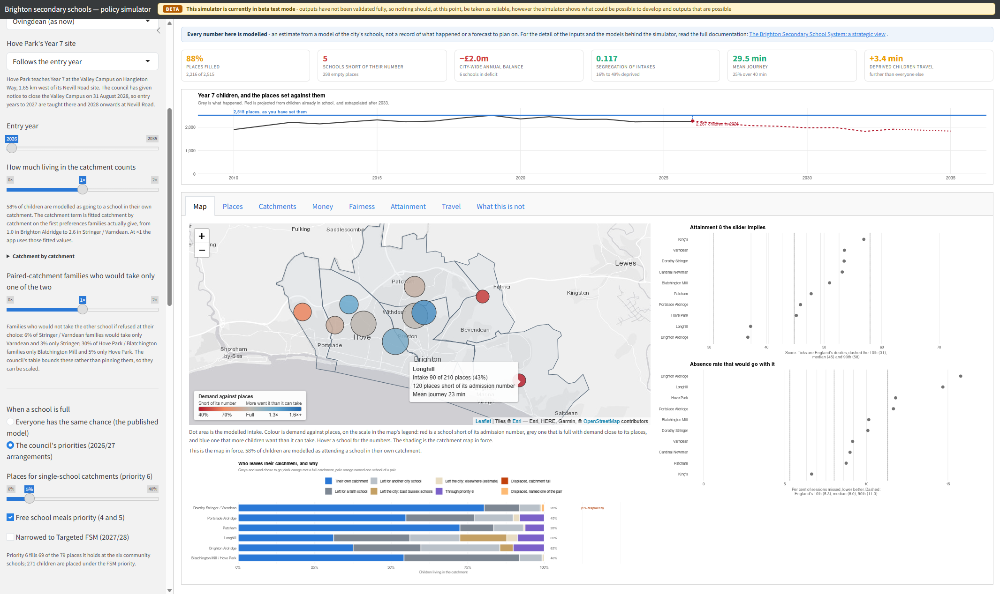{.nostretch fig-align="center"
width="64%"}

::: {style="font-size:0.75em"}
- Simulator has both pre-built scenarios I imagined plus scope to change
  each element.
- Built in about two days. "what if" questions became cheap to ask multiple times
:::

## Back to the first question {.smaller}

```{r lh-steps}
#| include: false
# Read off the simulator for 2026 entry, one control changed at a time.
# Screenshots of each state are in slides_assets.
steps <- tibble::tibble(
  step  = factor(1:4),
  label = c("Today", "Families read value added",
            "+ Elm Grove, Whitehawk back", "+ value added doubled"),
  intake = c(90, 106, 140, 197),
  pct    = c(43, 50, 67, 94),
  dep    = c(3.4, 2.5, -1.9, -2.2),
  seg    = c(0.117, 0.127, 0.176, 0.188))
st <- function(i, col) steps[[col]][i]
```

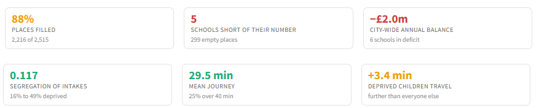{.nostretch fig-align="center" width="56%"}

> *"What is causing Longhill's acute numbers problem — is it geography,
> demography, attractiveness, some combination or something else? Would
> moving and/or shrinking it help it survive, or improve anything
> else?"*


- The honest answer is **none of them on their own**.
- Longhill is not short of children for one reason, so no single lever
  fixes it.
- What the simulator lets you do is pull them **one at a time, and watch them compound**.
- **Today, 2026.**
   -   Longhill takes **`r st(1,"intake")` of 210 places (modelled)
(`r st(1,"pct")`%)**, 120 short. 
   -   A disadvantaged child travels **`r sprintf("%+.1f", st(1,"dep"))` minutes further** than everyone else.


## 1st Lever: families read value added {.smaller .simstep}

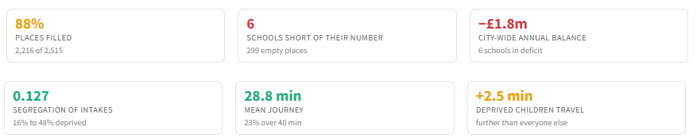{fig-align="center" width="56%"}

:::::: columns
::: {.column width="58%"}
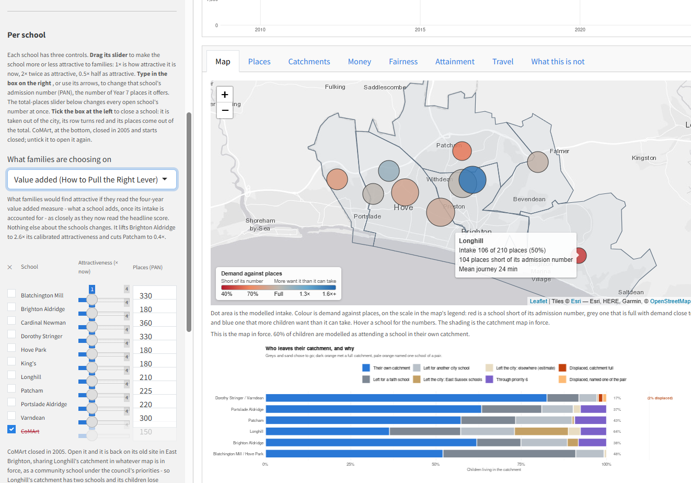{.sim-wide fig-align="center"}
:::

:::: {.column width="42%"}
One dropdown. Families read the **four-year value added measure** — what a school adds once intake is accounted for — as closely as they now read the headline score. Nothing about the schools changes.

Longhill goes from **`r st(1,"intake")`** to **`r st(2,"intake")` of 210
(`r st(2,"pct")`%)**.

::: key-finding
The travel gap falls from **`r sprintf("%+.1f", st(1,"dep"))`** to
**`r sprintf("%+.1f", st(2,"dep"))` minutes**, the city's mean journey
drops by 42 seconds, and segregation rises slightly.
:::
::::
::::::

## 2nd Lever: move it, restore its catchment {.smaller .simstep}

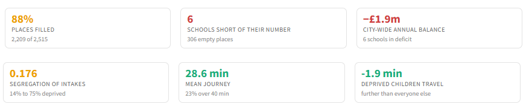{fig-align="center" width="56%"}

:::::: columns
::: {.column width="58%"}
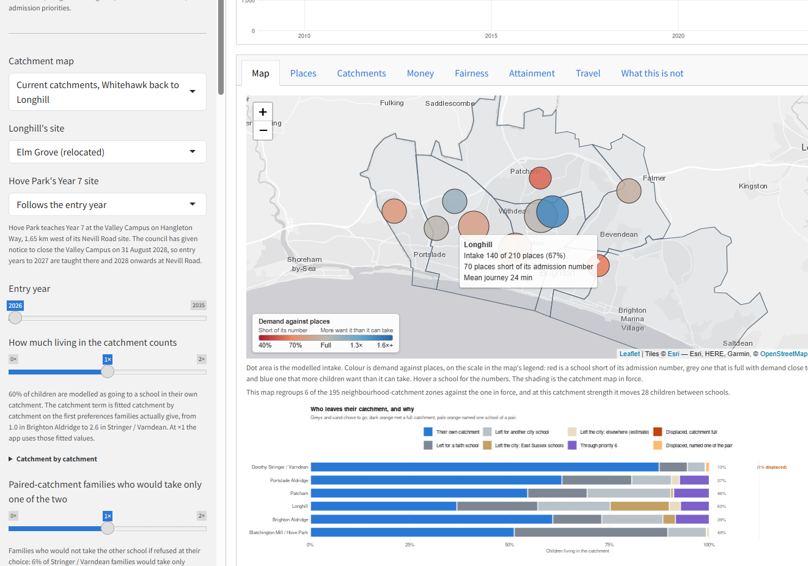{.sim-wide fig-align="center"}
:::

:::: {.column width="42%"}
Two more controls: Longhill relocates to **Elm Grove**, and **Whitehawk
returns to the Longhill catchment** it sat in before 2024.

Longhill reaches **`r st(3,"intake")` of 210 (`r st(3,"pct")`%)**, and
the travel gap **reverses**: disadvantaged children now travel
**`r sprintf("%.1f", abs(st(3,"dep")))` minutes less** than their
classmates. Segregation rises, but no child is displaced from a central catchment.

::: key-finding
Redrawing the catchments as flow regions around the new site was also
tested. It did **worse** — a travel gap of −1.0 against −1.9, and twice
the displacement.
:::
::::
::::::

## 3rd Lever: and if it taught like BACA {.smaller .simstep}

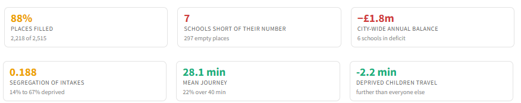{fig-align="center" width="56%"}

:::::: columns
::: {.column width="58%"}
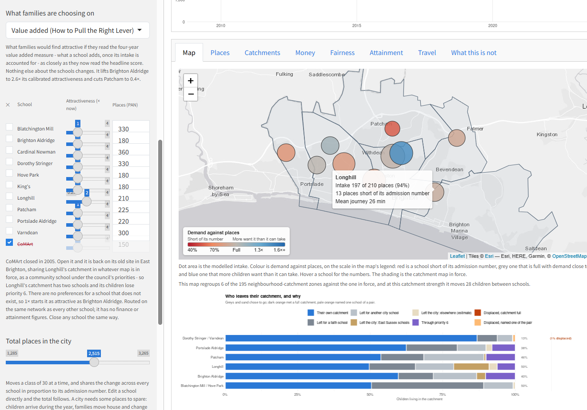{.sim-wide fig-align="center"}
:::

:::: {.column width="42%"}
The last lever is not an admissions policy. It is **the school getting
better** — value added doubled, to roughly where Brighton Aldridge
(BACA) stood over the four years to 2024/25, on a comparably
disadvantaged intake.

Longhill reaches **`r st(4,"intake")` of 210 — `r st(4,"pct")`% full**,
13 places short, **1% of children displaced** city-wide.

::: key-finding
A disadvantaged child now travels
**`r sprintf("%.1f", abs(st(4,"dep")))` minutes *less*** than everyone
else — a swing of `r sprintf("%.1f", st(1,"dep") - st(4,"dep"))`
minutes. Absence is this city's largest attainment problem, and distance
is one of the few things policy can change about it.
:::
::::
::::::

## Why this needs a simulator {.smaller}

:::::: columns
::: {.column width="56%"}
```{r lh-compound}
#| fig-width: 7.0
#| fig-height: 4.4
sl <- steps |>
  dplyr::mutate(lab = stringr::str_wrap(label, 18),
                lab = factor(lab, levels = stringr::str_wrap(label, 18)))
ggplot(sl, aes(lab, pct, group = 1)) +
  geom_hline(yintercept = 100, linetype = "31", colour = "grey60") +
  geom_line(linewidth = 1.1, colour = BAD) +
  geom_point(size = 3.6, colour = BAD) +
  geom_text(aes(label = sprintf("%d%%", pct)), vjust = -1.1, size = 4.4, colour = INK) +
  scale_y_continuous(limits = c(0, 112)) +
  labs(x = NULL, y = "Longhill's places filled",
       title = "No single lever fills Longhill. Four together nearly do.",
       subtitle = "2026 entry. Each step keeps the one before it.") +
  theme_bhs(12) +
  theme(axis.text.x = element_text(size = 9))
```
:::

:::: {.column width="44%"}
Each choice is modest on its own. **`r st(2,"pct")-st(1,"pct")` points,
then `r st(3,"pct")-st(2,"pct")`, then `r st(4,"pct")-st(3,"pct")`.**
None would survive a committee on its own merits. Together they take a
school from 43% full to 94%.

**Segregation rises**, `r sprintf("%.3f", st(1,"seg"))` to
`r sprintf("%.3f", st(4,"seg"))`. That is the honest cost.

::: key-finding
But *How to Pull the Right Lever* finds the attainment model **disagrees
about direction** between disadvantaged and other pupils — so
deconcentration bought with longer journeys is unlikely to help the
children it is meant to.
:::

You cannot reason about this in a committee paper. Every lever moves
every other one, and you have to **see each choice land**.
::::
::::::

<!-- ## Worked example: a question only a human asks {.smaller} -->

<!-- Families choose schools on the published Attainment 8 score — which -->

<!-- mostly measures the intake, not the teaching. -->

<!-- I asked: **what if they chose on value added instead?** -->

<!-- :::::: columns -->

<!-- ::: {.column width="50%"} -->

<!-- That is not a coding task. It is a question about how a city might -->

<!-- behave differently, and it took about a day to answer properly: a new -->

<!-- attractiveness basis, a switch in the simulator, a measure of how evenly -->

<!-- children would be spread. -->

<!-- ::: -->

<!-- :::: {.column width="50%"} -->

<!-- ::: key-finding -->

<!-- The answer: one struggling school's intake nearly doubles, the surplus -->

<!-- stops concentrating in three schools — and the total number of empty -->

<!-- places does not move at all. -->

<!-- ::: -->

<!-- :::: -->

<!-- :::::: -->

<!-- ## What the city would look like {.smaller} -->

<!-- ```{r fig-va} -->

<!-- #| fig-width: 11 -->

<!-- #| fig-height: 4.4 -->

<!-- va <- vac$detail |> -->

<!--   mutate(school = forcats::fct_reorder(short_sch(name), mult), -->

<!--          up = mult >= 1) -->

<!-- ggplot(va, aes(mult, school)) + -->

<!--   geom_vline(xintercept = 1, colour = GREY, linetype = "31") + -->

<!--   geom_segment(aes(x = 1, xend = mult, yend = school, colour = up), linewidth = 1.1) + -->

<!--   geom_point(aes(colour = up), size = 4) + -->

<!--   geom_text(aes(label = sprintf("%.2f x", mult), hjust = ifelse(up, -0.3, 1.3)), -->

<!--             size = 4.1, colour = INK) + -->

<!--   scale_colour_manual(values = c(`TRUE` = "#2b7a4b", `FALSE` = WARM), guide = "none") + -->

<!--   scale_x_continuous(limits = c(0, 3.2)) + -->

<!--   labs(x = "Change in how attractive the school looks", y = NULL, -->

<!--        title = "If families read value added instead of Attainment 8", -->

<!--        subtitle = "Multiplier on each school's attractiveness. 1.0 = no change.") + -->

<!--   theme_talk(14) + -->

<!--   theme(panel.grid.major.y = element_blank(), -->

<!--         panel.grid.major.x = element_line(colour = "#e8e4f0", linewidth = 0.4)) -->

<!-- ``` -->

<!-- ::: {style="font-size:0.72em"} -->

<!-- Brighton Aldridge — the lowest Attainment 8 in the city — is adding more -->

<!-- progress than almost anywhere. Patcham, comfortably mid-table on the -->

<!-- headline number, is bottom of the city on value added. -->

<!-- ::: -->

<!-- ## Worked example: catching it being wrong {.smaller} -->

<!-- :::::: columns -->

<!-- ::: {.column width="54%"} -->

<!-- Claude reported a school's value-added score as being in the "top 100% -->

<!-- in England". It had applied an Attainment 8 percentile function to a -->

<!-- value-added figure. Silently wrong, confidently stated. -->

<!-- Later, the attainment charts appeared to show huge jumps when the -->

<!-- value-added option was selected — because they were reading a different -->

<!-- variable than I thought. -->

<!-- I caught both. It fixed both in minutes. -->

<!-- ::: -->

<!-- :::: {.column width="46%"} -->

<!-- ::: key-finding -->

<!-- The failure mode is not gibberish. It is **plausible, well-formatted, -->

<!-- confidently-presented wrongness** — exactly what a domain expert catches -->

<!-- and a non-expert does not. -->

<!-- ::: -->

<!-- This is the strongest argument I have for why the human in this loop has -->

<!-- to be someone who knows the subject. -->

<!-- :::: -->

<!-- :::::: -->

# How It Was Built {background-color="#361a54"}
## This started before April {.smaller}

:::::: columns
::: {.column width="65%"}
**2007-2026.** Twenty years of working with spatial interaction models, in contexts from migration to retail.

**October 2024.** Brighton & Hove is consulting on redrawing its
catchments. I write `BrighonSchoolsSIM.qmd` — **1,014 lines** of R and
Quarto. A production-constrained spatial interaction model of the city's schools.

I call the hypothetical baseline **Brightopia**: where every child would go if distance were the only thing that mattered.

**December 2024.** I write `bus_routes.qmd` — **1,021 lines** — setting
up `r5r`, a GTFS feed and an OSM extract to compute real
public-transport journey times to every school.

**2025-2026.** Months of work on the drivers of attainment in England, which fed straight into the attractiveness inputs.
:::

:::: {.column width="35%"}
::: key-finding
Two thousand lines of spatial interaction modelling and routing, written
by hand, eighteen months before any of this.
:::

That is what the new model was built **on**, not instead of. 

Brightopia
is still in the current document, as the $W_j = 1$ baseline the
calibrated model is measured against.


::::
::::::

## Five months, in one chart

::: {style="font-size:0.78em; color:#666688; margin-bottom:-0.3rem;"}
Counted, not remembered: **~250 MB of Claude Code session logs** across
ten sessions, plus the git history of six repositories. **1,277**
instructions from me, **13,451** tool calls back, over **69 working
days** spread across 166 — about ten and a half actions for every
sentence I typed. A snapshot; the work is still going.
:::


```{r fig-timeline}
#| fig-width: 11.5
#| fig-height: 4.8
ggplot(rec, aes(day)) +
  geom_col(aes(y = tool_calls), fill = BRIGHT, width = 1.9, alpha = 0.9) +
  geom_line(aes(y = instructions * 10), colour = WARM, linewidth = 0.9, linetype = "31") +
  scale_y_continuous(
    name = "Claude tool calls per day",
    sec.axis = sec_axis(~ . / 10, name = "My instructions per day")) +
  scale_x_date(date_breaks = "1 month", date_labels = "%b") +
  labs(x = NULL,
       title = "The work was bursty, and it accelerated",
       subtitle = "Bars: actions taken by Claude. Dashed line: instructions from me.") +
  theme_talk(14) +
  theme(axis.title.y.right = element_text(colour = WARM),
        axis.title.y.left  = element_text(colour = BRIGHT))
```

::: {style="font-size:0.72em"}
The April–July work is a different project — a national school
attainment model. The Brighton system model starts on **8 September**
and is finished eighteen days later.
:::

## The division of labour {.smaller}

:::::: columns
::: {.column width="49%"}
**What I brought**

- **The working prototype** — Brightopia, and the `r5r` routing
  pipeline, both written by hand in 2024
- Twenty years of building spatial interaction models: knowing that
  attractiveness, distance decay and competing destinations were the
  terms that mattered
- Knowledge of the school system, and of the city's politics
- Judgement about what is defensible to publish
- Knowing when an answer was wrong
- Every decision about what to do next
:::

::: {.column width="2%"}
:::

::: {.column width="49%"}
**What Claude brought**

- Scale: a hand-built prototype turned into a calibrated, audited system
- Data wrangling across a dozen published sources
- Shiny, deployment, rendering, version control
- Debugging, and the patience for it
- Documentation written as it went
- The willingness to redo all of it when one assumption changed
:::
::::::

::: key-finding
I knew what to ask for and what to examine, because I had built a
smaller version of it myself. **That is not a small part of why this
worked.**
:::

## What my instructions actually look like {.smaller}

::: {style="font-size:0.82em"}
Verbatim, from the logs. The counts are the tool calls that followed.
:::

:::::: columns
::: {.column width="50%"}
> **"fonts as well"**
>
> *13 characters → 58 actions*

> **"yes, build it"**
>
> *13 characters → 46 actions*

> **"yes, add Priory, Seahaven and Seaford Head as destinations"**
>
> *58 characters → 68 actions*
:::

:::: {.column width="50%"}
> **"Can you cite the sources and link to all of the data that is used
> in each section please then commit and push as I'm going to bed"**
>
> *128 characters → 52 actions*

::: key-finding
Median instruction: **199 characters**. About thirty-six words.
:::
::::
::::::

<!-- ## But the short ones only work if you know what to say {.smaller} -->

<!-- ::: {style="font-size:0.84em"} -->

<!-- > **"You need to update Figure 28 with the new model outputs. Also, can -->

<!-- > I have a table of the original Brightopia (**$W_j = 1$) model with the -->

<!-- > observed vs modelled expected numbers for each school" -->

<!-- > **"can I have a little section on how we arrived at the best** $W_j$ -->

<!-- > attractiveness factor — we end up using Attainment 8" -->

<!-- > **"can you just check whether the shared variance issues make a -->

<!-- > difference here? I don't think they do, but it might be worth checking -->

<!-- > using the Shapley work"** -->

<!-- ::: -->

<!-- ::: key-finding -->

<!-- These are instructions written in the language of the model. You cannot -->

<!-- issue them unless you already know what $W_j$ is, why it might be wrong, -->

<!-- and what would count as checking. -->

<!-- ::: -->

## 14–16 August: extending my own model {.smaller}

::::::::: columns
::::: {.column width="50%"}
::: {style="font-size:0.8em; color:#555;"}
**14 August**
:::

> "All of the code we need to extend the road network is contained
> within the original **`BrighonSchoolsSIM.qmd`** file... We use **R5R**
> to build the network... the new thing we can do to extend the bus
> network down to Peacehaven is use the **UK2GTFS** package."

::: {style="font-size:0.78em; color:#555;"}
My own file, my own method, and the specific package to go further with
it.
:::
:::::

::::: {.column width="50%"}
::: {style="font-size:0.8em; color:#555;"}
**16 August, 07:15**
:::

> "The Dorothy Stringer intake is modelled as low and interpreted as
> **bad location**. However, this isn't quite right... Stringer is low
> **not because it is inaccessible, but because it is central and close
> to other schools** that the model fills up more favourably. So this is
> a problem **inherent in this model**."

::: {style="font-size:0.78em; color:#555;"}
The right number, reached by the wrong mechanism - correction on the
interpretation.
:::
:::::
:::::::::

## 16–18 August: what to measure, and why it holds {.smaller}

::::::::: columns
::::: {.column width="44%"}
::: {style="font-size:0.8em; color:#555;"}
**16 August, 21:49**
:::

> "**Ascribing IDACI values to modelled students** going into schools in
> the spatial interaction model could give us a sense of the likely
> profile of disadvantage at each school."

::: {style="font-size:0.78em; color:#555;"}
This became the entire disadvantage layer.
:::
:::::

::::: {.column width="56%"}
::: {style="font-size:0.8em; color:#555;"}
**18 August**
:::

> "No matter what ideological political thinking might hope — **and this
> is the problem with ideology, it rarely survives coming into contact
> with reality** — across human systems the world over, **distance decay
> is a universal truth**, whether it relates to schools, retail,
> migration, commuting, health care accessibility or any other human
> process."

::: {style="font-size:0.78em; color:#555;"}
Not a fact to look up (more of a rant at Claude! 😂): knowing which
seventy years of literature the city's argument was about to collide
with.
:::
:::::
:::::::::

## 10 September: specifying the model {.smaller}

::::::: columns
:::: {.column width="50%"}
::: {style="font-size:0.8em; color:#555;"}
**11:17**
:::

> "Re-running the Brightopia model with $W_j$ attractiveness set to
> weighted preferences and using the **new** $c_{ij}$ matrix which fixed
> some of the travel times — where before we had some weird bus journeys
> where walking would have been faster — and with **setting the beta
> value to 1.7**."
::::

:::: {.column width="50%"}
::: {style="font-size:0.8em; color:#555;"}
**13:26, two hours later**
:::

> "Can we add in a **competing destinations term** too, to see if that
> fixes the Blatch / Hove Park under/over prediction... Also, we might
> need a **catchment term** in there too."
::::
:::::::

::: key-finding
Between those two messages, two of the five terms in the final equation
get specified — each named with the symptom it was meant to cure. None
of these six prompts is a correction. They are **design**.
:::

<!-- ## The routing, as it actually happened {.smaller} -->

<!-- :::::::: columns -->

<!-- ::::: {.column width="52%"} -->

<!-- I was running `r5r` myself. It broke: -->

<!-- ::: {style="font-size:0.72em"} -->

<!-- > **"`Error in purrr::map(): Caused by error in checkmate::assert_class(): argument "r5r_network" is missing`"** -->

<!-- ::: -->

<!-- Then, an hour later: -->

<!-- ::: {style="font-size:0.78em"} -->

<!-- > **"restarted R and re-ran, it's routing now — we now have a brand new -->

<!-- > travel matrix — can we now go back to the original analysis and re-run -->

<!-- > the models with the new travel matrix? Both the public and private -->

<!-- > analyses"** -->

<!-- > -->

<!-- > *213 characters → 35 actions* -->

<!-- ::: -->

<!-- ::::: -->

<!-- :::: {.column width="48%"} -->

<!-- ::: key-finding -->

<!-- This is the collaboration in one exchange. I built and debugged the -->

<!-- routing pipeline. It took the output and propagated it through every -->

<!-- model, every document and every figure that depended on it. -->

<!-- ::: -->

<!-- Neither of us could have done the other's half quickly. -->

<!-- :::: -->

<!-- :::::::: -->

<!-- ## Worked example: a school in the wrong place {.smaller} -->

<!-- :::::: columns -->

<!-- ::: {.column width="55%"} -->

<!-- The model had Hove Park School at its Nevill Road site. Reasonable — -->

<!-- that is the address in the published data. -->

<!-- Five months in, I realised: the school has operated **two campuses**. -->

<!-- Year 7 and 8 were at the Valley Campus, a mile away, until a closure -->

<!-- proposal in 2026. -->

<!-- The model had been calibrated on the wrong location for the children who -->

<!-- actually generate the demand. -->

<!-- ::: -->

<!-- :::: {.column width="45%"} -->

<!-- ::: key-finding -->

<!-- No amount of code quality would have caught this. It needed someone who -->

<!-- knew the city. -->

<!-- ::: -->

<!-- Re-calibrating moved about **a quarter of Hove Park's modelled intake** -->

<!-- between wards, and changed the disadvantage figures materially. -->

<!-- :::: -->

<!-- :::::: -->

<!-- ## What re-calibrating it showed {.smaller} -->

<!-- ```{r fig-hovepark} -->

<!-- #| fig-width: 11 -->

<!-- #| fig-height: 4.2 -->

<!-- mv <- hpc$move |> -->

<!--   select(year, Valley = valley, `Nevill Road` = nevill) |> -->

<!--   tidyr::pivot_longer(-year, names_to = "site", values_to = "intake") -->

<!-- ggplot(mv, aes(factor(year), intake, fill = site)) + -->

<!--   geom_col(position = position_dodge(width = 0.72), width = 0.66) + -->

<!--   geom_text(aes(label = round(intake)), -->

<!--             position = position_dodge(width = 0.72), vjust = -0.5, -->

<!--             size = 4.4, colour = INK) + -->

<!--   scale_fill_manual(values = c(Valley = GREY, `Nevill Road` = BRIGHT)) + -->

<!--   scale_y_continuous(limits = c(0, 205)) + -->

<!--   labs(x = "Entry year", y = "Modelled Year 7 intake", -->

<!--        title = "The same school, half a mile apart", -->

<!--        subtitle = "Modelled intake with Hove Park at the Valley Campus, and consolidated at Nevill Road") + -->

<!--   theme_talk(14) -->

<!-- ``` -->

<!-- ::: key-finding -->

<!-- Moving site is worth about **twelve extra children a year** — roughly a -->

<!-- 7% lift, from geography alone. Real, but far smaller than the school's -->

<!-- attractiveness. The question "is it the site or the reputation?" now has -->

<!-- a number attached. -->

<!-- ::: -->


## Catching Errors - In Prompts {.smaller}

::: {style="font-size:0.84em"}
Verbatim from the prompts. Four different kinds of wrong.
:::

::::: columns
::: {.column width="50%"}
**A statistic that cannot be true**

> "I'm not sure the 'where that would rank' percentage in the attainment
> tab table is correct for the value added drop down — **every school
> appears to be in the 99th or 100th percentile.**"

**The wrong input data entirely**

> "The 'system as it stands' in the open report **is incorrect**. The
> catchment areas in that map relate to the **pre-2024** consultation
> catchment areas."
:::

::: {.column width="50%"}
**Geometry that could not exist**

> "The Stringer Varndean catchment **can't be that big and weird
> shaped**, and the BACA catchment can't extend down over the
> alternative Longhill site — this needs to be scrapped."

**History the data does not contain**

> "Up until last year, **Whitehawk was in the Longhill catchment**... so
> for a long time Longhill did have a large number of students from
> deprived areas in its catchment. **I'm not sure if this is properly
> represented in the model?**"
:::
:::::

::: key-finding
None of these is gibberish. Each is plausible, well-formatted and
confidently presented — and each needed someone who knew either the
statistics or the city. The last one needed knowledge of the city's own
history, which is in no dataset anywhere.
:::

<!-- ## The other failure modes, honestly {.smaller} -->

<!-- | What went wrong | What it cost | -->

<!-- |:-----------------------------------|:-----------------------------------| -->

<!-- | A shell quoting slip corrupted two files | 20 minutes, fixed by regenerating | -->

<!-- | An optimiser fell into the wrong basin | Caught by a sanity check on one school's intake | -->

<!-- | A variable name collision inside the app | Silent wrong behaviour until tested | -->

<!-- | Model outputs stale after re-calibration | Needed a discipline of re-running everything | -->

<!-- | Confident summaries of work not yet verified | Needed me to ask "did you actually check?" | -->

<!-- ::: {style="font-size:0.78em"} -->

<!-- None of these are exotic. They are the ordinary failure modes of a fast, -->

<!-- capable, over-confident collaborator — and they are managed the same way -->

<!-- you manage those in a person: tests, checks, and someone reading the -->

<!-- output. -->

<!-- ::: -->

## The workflow {.smaller}

:::::: columns
::: {.column width="52%"}
Everything is **Quarto**. The analysis document, the technical guide,
the slide decks — all `.qmd`, all executing live R against the same
data.

The loop, many times a day:

1.  I say what I want, in two or three sentences
2.  Claude edits the source and runs it
3.  It renders, screenshots, checks the numbers
4.  It commits and pushes
5.  I read the output and react

When I asked *"does the Hove Park change affect section 5.5?"*, that was
an answerable question — because section 5.5 is code, and code re-runs.
:::

:::: {.column width="48%"}
::: key-finding
The document **is** the analysis. There is no separate "writing up" —
changing the model changes the paragraph that describes it, because the
paragraph is generated from the model.
:::

Reproducibility stops being a virtue you aspire to and becomes the only
way the thing can work at this speed. Hand-copied into Word, none of it
would survive its own rate of change.

Git is the memory. 805 commits, each with a message explaining why.
::::
::::::

## The recursion {.smaller}

The interesting part is not that AI wrote code. It is the workflow **loop**:

::: incremental
1.  A model produces a result.
2.  The result goes into a document, written to be read by
    me/stakeholders
3.  Claude writes the commentary as it goes.
4.  Writing it plainly is what exposes the holes.
5.  A hole becomes the next question for the model.
6.  Answering it changes the model — and the document rewrites itself.
7.  Go round again.
:::

. . .

That cycle ran perhaps two hundred times. Each turn took minutes, not
weeks. **That compression is the whole story.**

The process is not unlike supervising a PhD student or a research assistant. The difference is that a turn of the loop takes minutes rather than weeks.

# Where This Leaves Us {background-color="#361a54"}
## What I would say to a colleague {.smaller}

::::: columns
::: {.column width="50%"}
**It does not replace knowing things.** Every moment that mattered in
this project turned on domain knowledge I had and it did not.

**It does collapse the cost of trying.** The scenarios I tested would
each have been a week of work. Testing twenty of them was previously
impossible, so I would have tested two.
:::

::: {.column width="50%"}
**It writes better documentation than I do**, because it never gets
bored of writing it.

**It needs supervision that looks like peer review**, not like
proofreading.

**The bottleneck moved.** It is no longer implementation. It is knowing
which question is worth asking.
:::
:::::

## What about collective intelligence? {.smaller}

:::::: columns
::: {.column width="54%"}
AI and expert input together have produced something that did not exist
before: **a working simulation of the city's school system that anyone
can open and argue with** — councillors, officers, school leaders,
parents.

That is necessary, and it is not sufficient. There is still a gap
between knowing how the system behaves, understanding what each policy
lever does to it, and arriving at something the city can live with.

**Three things still stand in the way:**

- **Awareness.** Most people affected do not know the tool exists.
- **Buy-in.** It only helps if the people who decide will use it.
- **Enough ideas.** A simulator is only as good as the range of
  scenarios people think to put through it.
:::

:::: {.column width="46%"}
::: key-finding
**What I am asking for.**

**If you work in the council or a school:** put a scenario through it
that you think will embarrass the model. That is the most useful thing
anyone can do with it.

**If you are a researcher:** the code, the data and the model are all
open. Take it apart.

**If you are a parent or a governor:** use it before the next
consultation, not after.
:::

The simulator is the argument made inspectable. It does not tell the
city what to do. It makes it much harder to claim a policy will do
something the system cannot deliver.
::::
::::::
## Links

::: {style="font-size:0.9em"}
- The analysis — <https://adamdennett.github.io/bh-school-system/>
- The simulator —
  <https://adamdennett-bh-school-system.share.connect.posit.cloud/>
- The national report —
  <https://adamdennett.github.io/school_attainment_tool/>
- Everything is open source on GitHub
:::

::: key-finding
Happy to be argued with — particularly about the open questions.
:::

# Any Questions? {background-color="#993bff"}
# Backup {background-color="#361a54"}
## Open questions {.smaller}

::: incremental
- **Authorship.** What is the honest way to describe this on a paper? I
  directed every step and verified every output — but I did not write
  the code.
- **Verification at speed.** I can generate analysis faster than I can
  properly check it. That is a new kind of risk.
- **Reproducibility of the process.** The code is reproducible. The
  *conversation* that produced it is not, in any meaningful sense.
- **Who else can do this?** This worked because I could tell right from
  wrong. What happens when the person in the loop cannot?
:::

